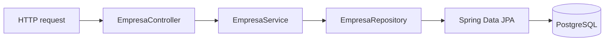

# Arquitectura backend — Amaint

| Campo | Detalle |
|---|---|
| Documento | Arquitectura backend |
| Tecnología actual | Java 21, Spring Boot 4.1.2, Spring MVC, Spring Data JPA, Bean Validation, PostgreSQL |

## 1. Propósito

Definir las responsabilidades del backend, la organización interna propuesta y los criterios para exponer casos de uso mediante API REST. El backend deberá ser la autoridad para aplicar reglas de negocio, seguridad y aislamiento multiempresa.

## 2. Stack y estado actual

Según `backend/pom.xml` y configuración:

- Java 21.
- Spring Boot 4.1.2.
- Spring Web MVC.
- Spring Data JPA.
- Spring Boot Validation.
- Driver PostgreSQL.
- Servidor configurado en puerto `8080`.
- Base de datos local configurada como `amaint_db`.

### Diferencias entre documentación y código

El `backend/README.md` enumera Spring Security como tecnología del backend, pero `pom.xml` no contiene `spring-boot-starter-security` y el código revisado no implementa autenticación ni autorización. Por tanto, la seguridad RBAC es un requisito pendiente de implementación, no una capacidad actual.

## 3. Estructura implementada

```text
backend/src/main/java/cl/amaint/api/
├── AmaintApiApplication.java
├── controller/
│   └── EmpresaController.java
├── entity/
│   └── Empresa.java
├── repository/
│   └── EmpresaRepository.java
├── service/
│   └── EmpresaService.java
└── exception/
    └── GlobalExceptionHandler.java
```

La funcionalidad existente de empresas sigue un flujo por capas:



`EmpresaController` publica operaciones de lectura, creación, actualización, cambio de estado y eliminación. `EmpresaService` concentra validaciones de unicidad de RUT y operaciones transaccionales. `EmpresaRepository` extiende `JpaRepository`.

## 4. Estilo de backend propuesto

**Monolito modular con capas internas.** Mantener un único despliegue Spring Boot al inicio y separar funcionalidades por módulo de negocio. Esto permite mantener límites claros sin introducir complejidad de red, despliegue y consistencia distribuida antes de necesitarla.

### Estructura lógica propuesta

```text
cl.amaint.api/
├── AmaintApiApplication.java
├── shared/
│   ├── config/
│   ├── security/
│   ├── exception/
│   └── audit/
├── platform/
│   ├── organization/
│   ├── user/
│   ├── membership/
│   ├── role/
│   └── subscription/
├── assets/
├── incidents/
├── workorders/
├── inventory/
├── notifications/
├── analytics/
└── synchronization/
```

Dentro de cada módulo, introducir cuando corresponda:

- `controller`: endpoints y adaptación HTTP.
- `dto`: objetos de entrada/salida y validación.
- `service` o `application`: casos de uso y coordinación transaccional.
- `domain`: reglas y objetos de dominio que aporten valor.
- `repository`: interfaces de persistencia.
- `entity`: mapeo JPA si se mantiene separado del dominio.

La estructura se puede adoptar gradualmente. No es necesario crear carpetas vacías para módulos que todavía no se implementan.

## 5. Flujo de una solicitud

1. Recibir la solicitud en el controller.
2. Resolver identidad del solicitante mediante el mecanismo de autenticación aprobado.
3. Resolver organización activa y permisos en el servidor.
4. Validar formato y campos mediante DTOs y Bean Validation.
5. Delegar al servicio/caso de uso.
6. Aplicar reglas de negocio y consultar/actualizar repositorios dentro de transacciones apropiadas.
7. Registrar auditoría para las acciones que lo requieren.
8. Convertir el resultado en DTO y responder con estado HTTP adecuado.

Los controladores no deben contener lógica de negocio, consultas directas ni decidir por sí solos el alcance multiempresa.

## 6. Seguridad, identidad y multiempresa

La seguridad debe implementarse en el servidor:

- Autenticación de cada usuario.
- Autorización basada en roles y permisos (RNF-4).
- Resolución de la organización a la que pertenece la operación.
- Verificación del alcance de cada recurso antes de leerlo o modificarlo.
- Separación de permisos de administración central frente a los administradores de cada empresa.
- Registro de acciones críticas de OT e inventario (RNF-5).

**Regla propuesta:** no confiar en un `empresaId` enviado por el navegador como prueba de autorización. La organización autorizada debe derivarse de la identidad y membresía autenticadas en el backend; los filtros de organización deben aplicarse también en consultas y escrituras.

La estrategia concreta (sesión/cookie, token, expiración, renovación, cierre de sesión, restablecimiento de credenciales) sigue pendiente. Consultar ADR-001 para aislamiento de datos.

## 7. Transacciones y consistencia

Operaciones que deben ser atómicas o coordinarse transaccionalmente:

- Despacho de repuestos: validar OT activa, comprobar stock, registrar movimiento y descontar cantidad (RF-4, RF-10, HU-06).
- Cierre de OT: comprobar checklist obligatorio, horas/ejecución y validación de repuestos antes de cambiar estado (RF-5, HU-05).
- Creación de OT desde una incidencia: mantener trazabilidad entre ambos registros.
- Recepción de una operación offline: registrar una vez y conservar resultado de sincronización para reintentos.

Se recomienda utilizar `@Transactional` en la capa de servicio/aplicación para delimitar estas operaciones, acompañándolo de restricciones e índices en PostgreSQL. La implementación debe evitar confiar en que una validación previa aislada protege de concurrencia en stock.

## 8. Validación y errores

`Empresa` utiliza Bean Validation para campos obligatorios, longitud y formato de RUT. `GlobalExceptionHandler` captura errores de validación y `ResponseStatusException`.

Para la API completa, se propone:

- Recibir DTOs en lugar de entidades JPA directamente.
- Validar rangos, estados permitidos, relaciones y permisos antes de persistir.
- Devolver respuestas de error consistentes: código, mensaje legible, detalles de campo y un identificador de correlación cuando exista.
- No incluir stack traces, SQL, secretos ni datos de otras organizaciones.
- Usar códigos HTTP coherentes: `201` creación, `200` consulta/actualización, `204` eliminación sin contenido, `400` validación, `401` no autenticado, `403` sin permiso, `404` recurso inexistente o fuera del alcance visible, `409` conflicto de negocio.

El contrato de error actual no es uniforme: el controlador devuelve entidades `Empresa` directamente y el handler usa mapas JSON distintos para validación y estado. La estandarización es una mejora propuesta.

## 9. Persistencia y migraciones

Spring Data JPA y PostgreSQL ya están presentes. `application.properties` configura `spring.jpa.hibernate.ddl-auto=update` y `spring.jpa.show-sql=true`, opciones útiles durante desarrollo inicial pero que deben revisarse antes de producción.

Se recomienda:

- Utilizar migraciones versionadas (Flyway o Liquibase, tecnología por seleccionar) para controlar cambios de esquema.
- Evitar `ddl-auto=update` como mecanismo de cambio en producción.
- Desactivar la impresión de SQL y revisar el nivel de logs en producción.
- Configurar credenciales y URL mediante variables de entorno/secret manager.
- Definir pool de conexiones, timeouts y health checks junto a la infraestructura.

## 10. API REST y CORS

El controlador existente usa `@RequestMapping("/api/empresas")` y `@CrossOrigin(origins = "http://localhost:5173")`. El script `dev` del frontend configura Vite en el puerto `3000`; por ello hay una discrepancia de origen que debe corregirse al integrar los proyectos.

La configuración CORS debe centralizarse por entorno y permitir únicamente los orígenes necesarios. CORS no reemplaza autenticación ni autorización.

La convención de rutas versionadas y DTOs se desarrolla en [Contrato de API](api-contract.md).

## 11. Auditoría y notificaciones

- La auditoría debe registrar quién realizó la acción, organización, momento, tipo de acción, entidad afectada y resultado, sin guardar credenciales ni secretos.
- Las operaciones de OT y stock están explícitamente incluidas en RNF-5.
- Las notificaciones deben generarse ante los eventos definidos por RF-8 y HU-04. Los destinatarios, canales, reintentos y garantía de entrega siguen pendientes.
- Evitar enviar notificaciones duplicadas cuando una operación offline se reintenta.

## 12. Pruebas de backend

La estrategia deberá incluir:

- Unit tests para reglas de dominio y servicios.
- Tests de integración de repositorios/transacciones con PostgreSQL de prueba.
- Tests de API para validación, estados HTTP y permisos.
- Pruebas negativas de aislamiento multiempresa.
- Pruebas de concurrencia en descuento de inventario.
- Pruebas idempotentes de sincronización.
- Pruebas de rendimiento para RNF-1 y carga de 50 usuarios para RNF-2.

## 13. Pendientes de validación

1. Incorporar y configurar Spring Security.
2. Aprobar la estrategia de autenticación y gestión de sesiones/tokens.
3. Aprobar el modelo de aislamiento multiempresa (ADR-001).
4. Confirmar proveedor de PostgreSQL y responsabilidades de Supabase (ADR-002).
5. Elegir herramienta de migraciones.
6. Definir límites de cada módulo y contratos DTO.
7. Formalizar auditoría, eventos de notificación y almacenamiento de evidencias.
8. Definir mecanismo de procesamiento de sincronización y resolución de conflictos offline.
9. Corregir/centralizar CORS para que coincida con los orígenes reales por entorno.

## 14. Referencias

- `backend/pom.xml`.
- `backend/src/main/resources/application.properties`.
- `backend/src/main/java/cl/amaint/api/`.
- `backend/README.md`.
- `frontend/package.json` y `frontend/vite.config.ts`.
- `docs/requirements/`.
