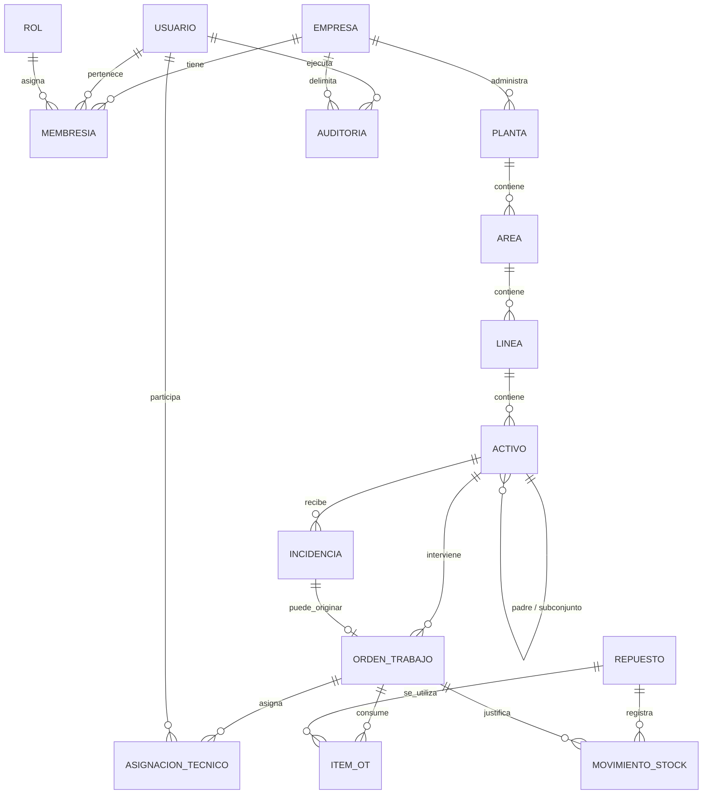

# Arquitectura de datos — Amaint

| Campo | Detalle |
|---|---|
| Documento | Arquitectura de datos y persistencia |
| Motor actual | PostgreSQL con Spring Data JPA/Hibernate |

## 1. Propósito

Documentar la persistencia actual y proponer criterios para el modelo de datos de Amaint. Este documento presenta un modelo conceptual; no constituye todavía un diagrama entidad-relación físico ni un esquema SQL aprobado.

## 2. Estado actual observado

- `backend/pom.xml` incluye Spring Data JPA y el driver PostgreSQL.
- `application.properties` conecta a `jdbc:postgresql://localhost:5432/amaint_db`.
- La entidad JPA visible es `Empresa`, mapeada a la tabla `empresa`.
- `Empresa` contiene `id`, `razonSocial`, `nombreComercial`, `rut`, `activo` y `fechaCreacion`; RUT es único y razón social/RUT son obligatorios.
- `EmpresaRepository` permite listar, buscar por ID/RUT y comprobar la unicidad del RUT.
- No se observan todavía entidades de usuarios, membresías, activos, incidencias, órdenes de trabajo ni inventario.
- Hibernate está configurado con `ddl-auto=update` y `show-sql=true`, propios de una configuración inicial que deberá revisarse antes de producción.

## 3. Principios de persistencia propuestos

1. PostgreSQL será la fuente persistente y transaccional de los datos operativos.
2. Spring Boot accede a la base mediante JPA/Repositories; el navegador no se conecta directamente a PostgreSQL.
3. Las relaciones y restricciones deben proteger integridad incluso frente a concurrencia.
4. Los datos operativos de cada organización deben quedar aislados (ver ADR-001).
5. Cambios del esquema deben versionarse mediante migraciones.
6. Mantener separados los datos de plataforma (organizaciones, suscripciones) de los datos operativos de cada organización.
7. Definir retención, backup, restauración y eliminación de datos antes del despliegue productivo.

## 4. Modelo conceptual propuesto

Las entidades siguientes son conceptos candidatos derivados de requisitos; nombres, atributos, cardinalidades y normalización deberán validarse en el diseño detallado.

El diagrama no fija que todas las relaciones sean obligatorias ni define tablas puente finales. Por ejemplo, el informe no determina si una OT puede originarse por más de una incidencia, si un activo puede participar en varias plantas o si las bodegas tienen múltiples ubicaciones.

## 5. Dominio de datos por módulo

| Área | Información conceptual | Trazabilidad |
|---|---|---|
| Plataforma | Empresa/organización, usuario, membresía, rol, módulos, configuración, licencia/suscripción. | README y visión multiempresa. |
| Estructura de planta | Planta, área, línea, activo y relación jerárquica padre-hijo. | RF-7, HU-01. |
| Ficha de activo | Código, fabricante, modelo, serial, manuales y atributos técnicos. | RF-2, HU-02. |
| Incidencias | Código de reporte, activo, categoría, severidad, descripción, evidencia, estado y fechas. | RF-1, HU-03. |
| Órdenes de trabajo | Tipo, prioridad, fechas, estado, especialidad, técnicos, checklist y datos de ejecución. | RF-3, RF-5, HU-04, HU-05. |
| Inventario | Repuesto, SKU, unidad, stock, mínimos, punto de reorden y movimientos. | RF-4, RF-10, HU-06. |
| Analítica | Historial de fallas, duraciones, horas planificadas, costos y consumos. | RF-6, HU-09, HU-10. |
| Sincronización | Operaciones pendientes, identificador idempotente, dispositivo, estado, intentos y confirmación. | RF-9, HU-07, HU-08. |
| Auditoría | Actor, organización, acción, entidad afectada, fecha, resultado. | RNF-5. |

## 6. Aislamiento multiempresa

El README define que varias organizaciones tendrán usuarios, permisos, módulos y configuraciones propios. El informe inicial describe principalmente una empresa y no especifica el mecanismo técnico de aislamiento.

**Propuesta para el primer diseño:** una base PostgreSQL compartida y un esquema compartido, con `empresa_id` obligatorio en cada tabla con datos operativos pertenecientes a una organización. Las entidades globales de plataforma (por ejemplo, la propia empresa/organización y el catálogo de planes) tendrían un alcance distinto.

Condiciones mínimas si se aprueba esta alternativa:

- La organización de la operación se resolverá desde la identidad/membresía validada en backend.
- Toda consulta y escritura de datos operativos aplicará el ámbito de organización en el servidor.
- Las relaciones entre filas tenant-scoped deberán evitar referencias cruzadas entre empresas (por ejemplo, claves foráneas compuestas cuando corresponda).
- Los índices y restricciones únicas deben incluir el ámbito de empresa cuando la unicidad sea por organización (por ejemplo, código de activo si así se valida).
- Los accesos de administración central deberán estar explícitamente autorizados y auditados.
- Añadir pruebas automatizadas que intenten leer o modificar registros de otra organización.

Esta propuesta no debe implementarse hasta aprobar el ADR-001 y definir si la unicidad de códigos es global o por empresa.

## 7. Integridad y transacciones

- Código de activo único según el ámbito que acuerde el Product Owner (BR-06 pendiente).
- RUT de empresa único (regla ya implementada en `Empresa`).
- Reportes con número correlativo único por el ámbito acordado.
- Stock no negativo y movimientos de inventario asociados a una OT válida.
- Despacho de repuestos dentro de una transacción que verifique disponibilidad y descuente stock sin permitir sobregiro concurrente.
- Checklist, datos de ejecución y validación de repuestos como condiciones previas al cierre de OT.
- Operaciones de sincronización con identificador idempotente para evitar duplicación por reintentos.

## 8. Migraciones y configuración

La configuración actual utiliza `spring.jpa.hibernate.ddl-auto=update`. Se recomienda seleccionar Flyway o Liquibase y mantener migraciones numeradas en el repositorio. La elección concreta queda pendiente.

Para producción:

- No incluir contraseñas en archivos versionados.
- Usar variables de entorno o gestor de secretos.
- Desactivar `show-sql` o habilitarlo solo de forma controlada en entornos de desarrollo.
- Evitar `ddl-auto=update` como estrategia de cambios productivos.
- Definir copias de seguridad, retención, restauración y objetivo de recuperación.
- Separar datos de prueba/desarrollo de los datos reales.

## 9. Datos binarios y archivos

El informe contempla fotografías de fallas y manuales PDF. No está definido dónde se almacenarán. Se recomienda evaluar almacenamiento de objetos para archivos y guardar en PostgreSQL solo metadatos, propietario, ruta/clave de almacenamiento, tipo, tamaño, checksum y permisos. La elección del proveedor y la política de retención están pendientes.

## 10. Preguntas abiertas

1. ¿Una empresa podrá tener varias plantas y bodegas? ¿Una bodega puede atender más de una planta?
2. ¿El código del activo y el número de incidencia serán únicos globalmente o por empresa/planta?
3. ¿Un usuario podrá pertenecer a más de una empresa y tener roles distintos en cada una?
4. ¿Las suscripciones/licencias tendrán datos y permisos en esta misma base o en un contexto de plataforma separado?
5. ¿Qué archivos se guardan offline y durante cuánto tiempo?
6. ¿Qué política de backup, retención y restauración se exigirá?
7. ¿Se aprueba esquema compartido con `empresa_id` o se requiere mayor aislamiento físico?

## 11. Referencias

- `backend/src/main/resources/application.properties`.
- `backend/src/main/java/cl/amaint/api/entity/Empresa.java`.
- `backend/src/main/java/cl/amaint/api/repository/EmpresaRepository.java`.
- `backend/pom.xml`.
- `docs/requirements/business-rules.md`.
- `docs/requirements/functional-requirements.md`.
- `docs/requirements/non-functional-requirements.md`.
- `docs/requirements/traceability-matrix.md`.
