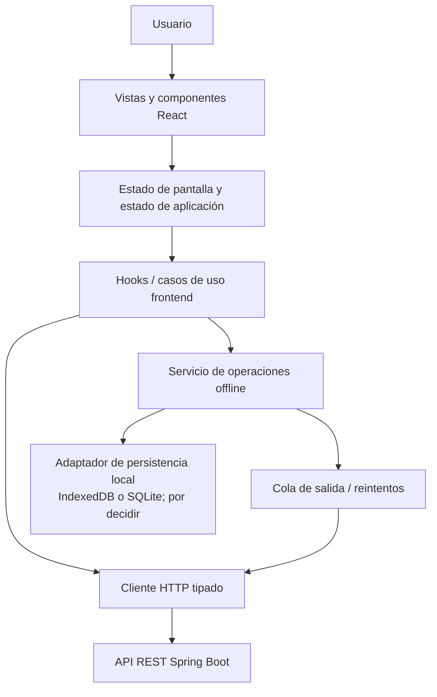

# Arquitectura frontend — Amaint

| Campo | Detalle |
|---|---|
| Documento | Arquitectura frontend |
| Tecnología actual | React, TypeScript, Vite |

## 1. Propósito

Definir la organización de la aplicación web, sus responsabilidades y la forma prevista de comunicarse con el backend. Se documenta la estructura actual y una evolución gradual; no se presupone que la integración o el modo offline persistente ya estén implementados.

## 2. Stack y punto de entrada actual

El proyecto utiliza React 19, TypeScript, Vite, Tailwind CSS y `lucide-react` (según `frontend/package.json`). `frontend/src/main.tsx` monta el componente `App`.

`App.tsx` compone `Header`, `Sidebar`, `Toast` y diez vistas funcionales. La navegación entre vistas se realiza mediante el estado `currentView` del `AppContext` y un `switch`; no se observa un router de rutas URL instalado.

## 3. Estructura actual relevante

```text
frontend/src/
├── App.tsx
├── main.tsx
├── context/
│   └── AppContext.tsx
├── data/
│   └── mockData.ts
├── types/
│   └── index.ts
└── components/
    ├── common/
    │   └── Toast.tsx
    ├── layout/
    │   ├── Header.tsx
    │   └── Sidebar.tsx
    └── modules/
        ├── MisOTsView.tsx
        ├── EscanerQRView.tsx
        ├── ReportarFallaView.tsx
        ├── ChecklistCierreView.tsx
        ├── JerarquiaActivosView.tsx
        ├── AsignacionOTsView.tsx
        ├── BodegaRepuestosView.tsx
        ├── SincronizacionLogsView.tsx
        ├── KpisConfiabilidadView.tsx
        └── CostosDisponibilidadView.tsx
```

### Estado observado

- Las vistas se agrupan por módulo funcional.
- Los tipos compartidos se encuentran en `types/index.ts`.
- `AppContext.tsx` centraliza el estado de la demo y operaciones simuladas.
- `mockData.ts` suministra los datos iniciales.
- No se encontró cliente HTTP ni solicitudes a la API en `frontend/src/`.
- No se encontró integración real con Supabase ni implementación persistente de IndexedDB/SQLite en el código revisado.
- La sincronización mostrada en la interfaz se simula mediante estado y temporizadores.

## 4. Arquitectura frontend objetivo

Se propone evolucionar hacia una organización por funcionalidades, manteniendo los componentes de presentación separados del acceso a datos.



## 5. Responsabilidades de las capas

| Capa | Responsabilidad | Regla |
|---|---|---|
| Presentación | Componentes y vistas; mostrar datos y capturar interacción. | No contener consultas SQL ni lógica de autorización confiable. |
| Aplicación frontend | Hooks y funciones que coordinan acciones de usuario y estado de pantalla. | Mantener las reglas de negocio autoritativas en el backend. |
| Acceso a API | Cliente HTTP, serialización, manejo de errores y tipos DTO. | Centralizar base URL, cabeceras, timeout y tratamiento de respuestas. |
| Estado remoto | Datos recibidos del backend y su caché. | Evitar duplicar manualmente en Context lo que gestione el cliente de datos seleccionado. |
| Persistencia offline | Guardar las operaciones permitidas y archivos pendientes. | Separar la interfaz de la tecnología concreta de almacenamiento. |
| Datos de demostración | Fixtures para desarrollo y pruebas visuales. | No mezclarlos con la fuente real en producción. |

## 6. Organización propuesta para la evolución

No es necesario reescribir el frontend de una sola vez. Se propone migrar progresivamente desde `components/modules` hacia límites por funcionalidad, conservando los componentes existentes mientras se incorpora el acceso al backend.

```text
frontend/src/
├── app/
│   ├── App.tsx
│   └── providers/
├── features/
│   ├── assets/
│   │   ├── components/
│   │   ├── hooks/
│   │   ├── services/
│   │   └── types.ts
│   ├── incidents/
│   ├── work-orders/
│   ├── inventory/
│   ├── analytics/
│   ├── organizations/
│   └── synchronization/
├── shared/
│   ├── api/
│   ├── auth/
│   ├── offline/
│   ├── components/
│   └── utils/
├── data/
│   └── mockData.ts
└── types/
```

Esta estructura es una propuesta, no una exigencia de mover todos los archivos antes de conectar la primera funcionalidad. Los nombres y límites definitivos deben seguir los módulos aprobados en la documentación de requisitos.

## 7. Integración con el backend

### 7.1. Cliente HTTP

Crear un cliente centralizado (por ejemplo, `shared/api/`) que:

- Obtenga la URL base desde una variable de entorno pública del frontend, sin credenciales privadas.
- Use HTTPS en entornos desplegados.
- Envíe y reciba JSON salvo endpoints explícitos para archivos.
- Centralice el manejo de códigos HTTP, errores de validación y expiración de sesión.
- Añada un identificador de correlación si se acuerda en el contrato API.
- No envíe un `empresaId` arbitrario como autoridad de acceso; el backend debe validar la organización activa del usuario autenticado.

La API debe exponer DTOs; el frontend no debería depender directamente de la forma interna de las entidades JPA.

### 7.2. Tipos

Los tipos actuales de `types/index.ts` representan estructuras de interfaz y datos de demo. Al conectar la API, separar:

- DTOs que reflejan contratos HTTP.
- Modelos de vista que necesita cada pantalla.
- Tipos de dominio compartidos, si realmente son necesarios.

Evitar reutilizar automáticamente los tipos del frontend como modelo persistente de Java.

### 7.3. Sustitución gradual de datos simulados

Para cada módulo:

1. Identificar los datos de `mockData.ts` y las acciones del `AppContext` que usa la vista.
2. Definir el endpoint y DTO requerido en el contrato API.
3. Crear funciones de acceso a datos y estados de carga/error/vacío.
4. Conectar un módulo a la vez.
5. Mantener fixtures solo para pruebas o modo demo explícito.
6. Verificar permisos y aislamiento de organización en el backend, no solo ocultando controles.

## 8. Estado y manejo de errores

El estado local de interfaz (modal abierto, filtro temporal, pestaña activa) puede permanecer en componentes o Context. Los datos persistentes compartidos (activos, OT, stock) deben provenir del backend una vez que la integración esté disponible.

Las pantallas deberán diferenciar al menos: carga, éxito, ausencia de datos, error recuperable, falta de autorización y operación pendiente de sincronización. Los errores del backend se traducirán a mensajes adecuados sin exponer trazas o datos internos.

## 9. Requisitos offline

RF-9, HU-07 y HU-08 requieren captura sin conectividad y sincronización posterior. La implementación deberá separar:

- Datos de referencia que pueden mantenerse en caché (por ejemplo, fichas de activos necesarias en terreno).
- Operaciones generadas offline (por ejemplo, reportes y formularios permitidos).
- Cola local durable, con estado de cada operación.
- Reintentos tolerantes a pérdida parcial de red.
- Identificador idempotente para evitar duplicados al reintentar.
- Confirmación del servidor antes de marcar una operación como sincronizada.
- Tratamiento visible de conflictos que requieran intervención.

La tecnología concreta no está decidida. El requisito HU-07 del informe menciona SQLite para una aplicación móvil, mientras que el repositorio actual contiene una aplicación React web. Consultar [ADR-003](decisions/ADR-003-offline-client.md) antes de implementar persistencia offline.

## 10. Seguridad frontend

- No almacenar secretos de base de datos, Supabase service keys ni secretos privados en código o variables `VITE_*`.
- No considerar el ocultamiento de elementos en la UI como control de acceso.
- Aplicar sesiones/token según la decisión de autenticación y protegerlos conforme a dicha estrategia.
- Minimizar datos sensibles en caché; definir expiración y borrado al cerrar sesión o cambiar de organización.
- Evitar registrar credenciales, tokens o contenido sensible de reportes en consola.

## 11. Pendientes de validación

1. ¿Amaint tendrá PWA instalable o una aplicación móvil nativa además del sitio web?
2. ¿Qué operaciones estarán disponibles offline en la primera versión?
3. ¿SQLite es una obligación del cliente móvil o puede utilizarse IndexedDB para una PWA web?
4. ¿Qué estrategia de autenticación consumirá el frontend?
5. ¿Se requiere router con URL profunda para cada módulo?
6. ¿Qué biblioteca de caché/estado remoto utilizará el equipo? No hay una seleccionada en las dependencias actuales.
7. ¿Cómo se entregarán y cachearán manuales PDF e imágenes de incidencias?

## 12. Referencias

- `frontend/package.json`, `frontend/vite.config.ts`.
- `frontend/src/main.tsx`, `App.tsx`, `context/AppContext.tsx`, `data/mockData.ts`, `types/index.ts`.
- `docs/requirements/functional-requirements.md` (RF-1 a RF-10).
- `docs/requirements/non-functional-requirements.md` (RNF-1 a RNF-8).
- `docs/requirements/user-stories.md` (HU-01 a HU-10).
