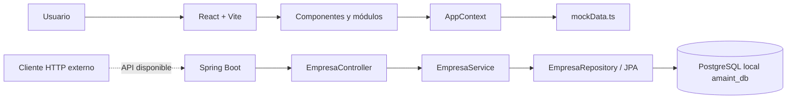
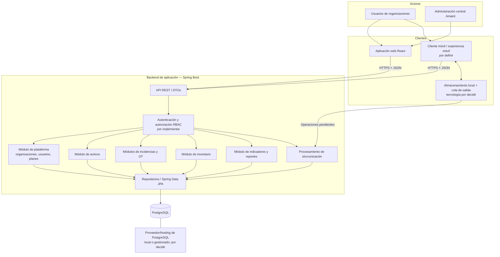

# Arquitectura general del sistema — Amaint

| Campo | Detalle |
|---|---|
| Documento | Arquitectura general del sistema |
| Fuentes | README del repositorio; `docs/vision/`; `docs/requirements/`; código de `frontend/` y `backend/` |

## 1. Propósito

Este documento describe el contexto de Amaint, los principales componentes de software, sus responsabilidades y la forma en que deben colaborar. Distingue entre la implementación que se observa hoy y la arquitectura objetivo propuesta para satisfacer los requisitos.

## 2. Resumen arquitectónico

Amaint se plantea como una plataforma CMMS multiempresa. La solución actual del repositorio contiene una aplicación web React y un backend Java con Spring Boot. PostgreSQL es el motor relacional configurado para el backend.

**Arquitectura objetivo propuesta:** aplicación React para presentación e interacción; API REST Spring Boot para autenticación, autorización, validación y reglas de negocio; PostgreSQL para persistencia. El backend será el único componente de aplicación que acceda directamente a la base de datos. Los clientes móviles u offline se conectarán a la misma API y tendrán un mecanismo local de almacenamiento y sincronización, cuya tecnología exacta continúa pendiente.

## 3. Estado actual observado



El diagrama representa lo que existe en el repositorio revisado; la flecha punteada no representa una integración React–Spring Boot ya implementada.

### Evidencia del estado actual

- **Frontend:** `main.tsx` monta `App`; `App.tsx` compone cabecera, navegación y diez vistas de módulos. `AppContext.tsx` mantiene el estado de órdenes, técnicos, repuestos, despachos, paquetes de sincronización y logs a partir de `mockData.ts`.
- **Integración:** no se encontraron llamadas `fetch`, Axios ni cliente Supabase dentro de `frontend/src/`. La aplicación utiliza estado local en memoria y datos simulados.
- **Backend:** hay una aplicación Spring Boot con capas `controller`, `service`, `repository`, `entity` y `exception`. La funcionalidad de negocio implementada visible corresponde a operaciones CRUD de `Empresa` en `/api/empresas`.
- **Datos:** la entidad JPA `Empresa` contiene razón social, nombre comercial, RUT, estado y fecha de creación. `application.properties` apunta a `jdbc:postgresql://localhost:5432/amaint_db`.
- **Autenticación:** no se observa configuración de Spring Security en `pom.xml` ni una cadena de filtros de seguridad en el código revisado, aunque el README del backend enumera Spring Security como tecnología prevista.
- **Offline:** las vistas muestran estados, colas y mensajes de sincronización simulados. No se encontró un adaptador persistente de IndexedDB/SQLite ni un servicio real de sincronización en el frontend.

## 4. Arquitectura objetivo propuesta



Los módulos del diagrama son límites lógicos propuestos dentro de una aplicación Spring Boot. No implican desplegarlos como servicios independientes.

## 5. Responsabilidades y límites

| Componente | Responsabilidad | No debe asumir |
|---|---|---|
| React | Presentar vistas, capturar entradas, validaciones de experiencia, navegación y estado de interfaz. | Ser la autoridad de permisos o ejecutar reglas de negocio críticas. |
| Cliente móvil/offline | Capturar trabajo en terreno, conservar datos pendientes localmente y solicitar sincronización. | Resolver por sí solo conflictos de datos compartidos ni acceder directamente a PostgreSQL. |
| API REST | Exponer contratos estables, validar entradas, autenticar/autorizar solicitudes y devolver resultados. | Contener cálculos complejos de negocio dentro de controladores. |
| Servicios de aplicación | Ejecutar casos de uso, coordinar transacciones y aplicar reglas de negocio. | Depender de componentes visuales o de detalles HTTP. |
| Repositorios | Persistir y consultar entidades mediante JPA. | Decidir permisos de usuario o reglas de flujo. |
| PostgreSQL | Mantener datos persistentes, relaciones, restricciones e integridad transaccional. | Ser accesible directamente desde el navegador del usuario. |

## 6. Módulos funcionales propuestos

Los módulos se derivan de `docs/requirements/functional-requirements.md` y de la visión del producto:

| Módulo lógico | Responsabilidades | Trazabilidad principal |
|---|---|---|
| Plataforma y organizaciones | Empresas, membresías, usuarios, roles, módulos y configuraciones. | Visión multiempresa; pendientes transversales. |
| Activos | Plantas, áreas, líneas, máquinas, subconjuntos, fichas y códigos QR. | RF-2, RF-7; HU-01, HU-02. |
| Incidencias | Reportes, categorías, severidad, evidencias y estado de revisión. | RF-1, RF-8; HU-03. |
| Órdenes de trabajo | Planificación, prioridad, especialidad, asignaciones, checklist y cierre. | RF-3, RF-5, RF-8; HU-04, HU-05. |
| Inventario | Catálogo de repuestos, stock, despachos y movimientos asociados a OT. | RF-4, RF-10; HU-06. |
| Offline y sincronización | Operaciones pendientes, reintentos, idempotencia y reconciliación. | RF-9; HU-07, HU-08. |
| Analítica | MTBF, MTTR, disponibilidad, costos y exportación de reportes. | RF-6; HU-09, HU-10. |
| Auditoría y notificaciones | Registro de acciones y generación/entrega de alertas. | RNF-5, RF-8. |

## 7. Estilo arquitectónico

**Propuesta: monolito modular.** El backend se desplegaría inicialmente como una aplicación Spring Boot, organizada por módulos de negocio y con límites internos explícitos. Cada módulo puede tener controladores, servicios, repositorios, entidades y DTOs propios, según necesidad.

Esta opción es adecuada como punto de partida para el tamaño actual del equipo y del repositorio: permite transacciones consistentes entre OT e inventario, reduce la complejidad operacional y mantiene abierta la posibilidad de extraer servicios en el futuro si aparecen necesidades medibles de escala o autonomía.

No hay evidencia actual que justifique microservicios, colas distribuidas o múltiples bases de datos.

## 8. Flujos arquitectónicos principales

### 8.1. Operación online

1. El usuario interactúa con una vista React.
2. El frontend envía una solicitud HTTPS a la API REST.
3. El backend autentica al usuario, determina su organización activa y comprueba permisos.
4. El controlador valida el contrato y delega el caso de uso a un servicio.
5. El servicio ejecuta reglas de negocio dentro de una transacción cuando corresponda.
6. El repositorio persiste o consulta datos en PostgreSQL.
7. La API devuelve DTOs y un código HTTP apropiado; React actualiza la vista.

### 8.2. Registro de una falla sin conectividad

```mermaid
sequenceDiagram
    actor Operador
    participant Cliente as Cliente móvil/web
    participant Local as Persistencia local
    participant Sync as Sincronizador
    participant API as API Spring Boot
    participant DB as PostgreSQL

    Operador->>Cliente: Completa reporte de falla
    Cliente->>Cliente: Valida datos requeridos
    Cliente->>Local: Guarda reporte y evidencia pendiente
    Local-->>Cliente: Confirma guardado local
    Note over Cliente,Local: Sin conectividad; estado pendiente de sincronización
    Cliente->>Sync: Detecta conectividad disponible
    Sync->>API: Envía operación con identificador idempotente
    API->>API: Autentica, autoriza y valida organización
    API->>DB: Registra reporte si no fue procesado antes
    DB-->>API: Confirma persistencia
    API-->>Sync: Confirma operación sincronizada
    Sync->>Local: Marca operación como sincronizada
```

La secuencia es objetivo propuesto. El medio de almacenamiento local y las reglas de resolución de conflictos aún deben aprobarse.

## 9. Requisitos de calidad que condicionan la arquitectura

- **Rendimiento:** RNF-1 requiere consultas de activos e historial bajo 1,5 s para el 95% de los casos; HU-02 especifica 500 ms. Debe conciliarse el umbral y el escenario de medición.
- **Concurrencia:** RNF-2 establece al menos 50 usuarios concurrentes.
- **Sincronización:** RNF-3/HU-08 establece menos de 5 s tras recuperar conectividad.
- **Seguridad:** RNF-4 a RNF-6 exigen RBAC, auditoría de cambios de OT/stock y cifrado en tránsito y en reposo/local según alcance.
- **Usabilidad:** RNF-7 exige interfaz responsive y contraste adecuado para el entorno industrial.
- **Disponibilidad:** RNF-8 establece 99,5% mensual durante el horario operativo de la planta.

La arquitectura por sí sola no demuestra estos atributos; se requieren pruebas y métricas de aceptación.

## 10. Decisiones aún no cerradas

1. Aislamiento multiempresa: consultar [ADR-001](decisions/ADR-001-multi-tenancy.md).
2. Uso concreto de Supabase y proveedor PostgreSQL: consultar [ADR-002](decisions/ADR-002-database-platform.md).
3. Aplicación móvil y persistencia offline: consultar [ADR-003](decisions/ADR-003-offline-client.md).
4. Mecanismo de autenticación, sesión y renovación de credenciales.
5. Alcance real de administración central y permisos excepcionales.
6. Hosting, proxy, dominios, certificados TLS, almacenamiento de imágenes y backups.
7. Definición de estados y transiciones de OT, prioridad/severidad y fórmulas de KPIs.

## 11. Fuentes

- `README.md` del repositorio.
- `backend/README.md`, `backend/pom.xml` y `backend/src/main/resources/application.properties`.
- `backend/src/main/java/cl/amaint/api/`.
- `frontend/package.json`, `frontend/vite.config.ts` y `frontend/src/`.
- `docs/vision/product-vision.md`.
- `docs/requirements/functional-requirements.md`.
- `docs/requirements/non-functional-requirements.md`.
- `docs/requirements/user-roles-and-permissions.md`.
- `docs/requirements/business-rules.md`.
